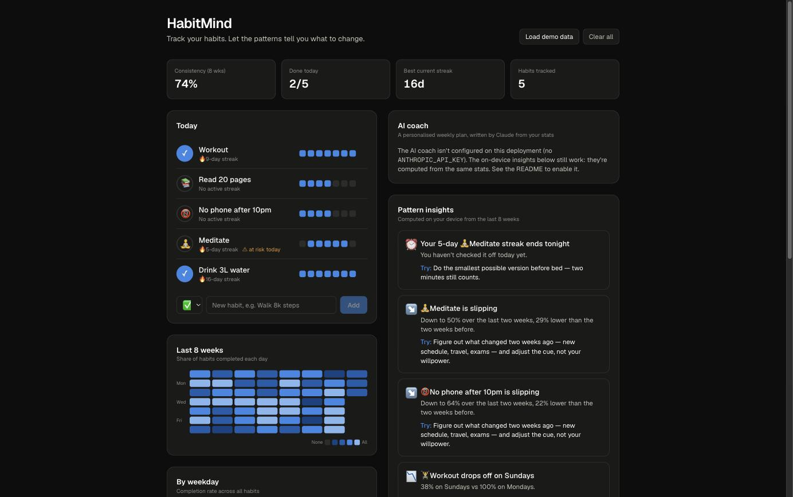

# HabitMind 🧠

**A personalised habit tracker with AI insights.** Check off your habits each day. HabitMind finds the patterns in your history, like weak weekdays, habits that are slipping, streaks about to break, and habits that tend to happen together. It then turns them into concrete suggestions. With an Anthropic API key, it also writes a weekly coaching plan with Claude.

[](https://github.com/pastbologanesh0101/habitmind/actions/workflows/ci.yml)


**Live demo:** https://habitmind-ai.vercel.app. Click **Load demo data** to see eight weeks of history with patterns built in.



## Features

- **Daily check-ins** with one tap, plus a 7-day strip for back-filling missed days
- **Streaks**: current and longest. Today only counts as a miss once the day is over, so a habit you haven't done by 9am isn't marked missed yet.
- **8-week heatmap** showing the share of habits completed each day, and a **weekday rhythm** chart with a table view
- **Pattern insights**, computed on-device and ranked by urgency:

  | Insight | Trigger |
  |---|---|
  | ⏰ Streak at risk | 3+ day streak, not done yet today |
  | ↘️ Slipping / ↗️ Improving | Last 14 days vs. the 14 before differ by ≥ 20 points |
  | 📉 Weekday dip | Worst weekday ≥ 40 points below best weekday |
  | 🔗 Habit link | P(B \| A done) − P(B \| A not done) ≥ 25 points, with ≥ 5 days on each side |
  | 🪶 Too big | < 40% completion after a week, so shrink it |
  | 🏆 Locked in | ≥ 85% over 2+ weeks, so use it as an anchor for habit stacking |

- **AI coach (Claude)**: a structured weekly plan with a focus habit, 2–4 suggestions that each cite a number, a 7-day experiment, and a closing note
- **Private by default**: the habit log lives in `localStorage`. The AI coach receives aggregated stats only (rates, streaks, weekday names), never the day-by-day log. A unit test enforces this.

## How the AI part works

```
browser                                   server (/api/insights)                 Claude
───────                                   ──────────────────────                 ──────
habits ─► analyze() ─► toCoachRequest() ─► zod validate (≤20 habits, bounds)
          (pure TS)    aggregates only     per-IP rate limit (5/min)
                                           messages.parse() ──────────────────► claude-opus-5-5
                                             • structured output (zod schema)     effort: medium
                                             • server-side refusal fallback
                                           ◄── typed CoachReport ◄──────────────
```

- **Structured outputs:** the report schema is a zod object (`CoachReportSchema`) passed through `betaZodOutputFormat`, so the UI gets typed JSON rather than free text to parse.
- **Grounded prompt:** the system prompt explains what each stat means and tells the model to cite a number for every observation and to describe habit links as correlations, not causes.
- **Robustness:** the route checks `stop_reason` for `refusal` and `max_tokens`, maps SDK errors (`AuthenticationError`, `RateLimitError`, `APIError`) to clear HTTP responses, and enables `fallbacks: "default"` so a declined request is retried on a fallback model on the server.
- **Graceful degradation:** without `ANTHROPIC_API_KEY`, `GET /api/insights` reports `enabled: false`. The UI hides the button, and the on-device insights still run, since they use the same stats.

## Architecture

```
src/
├── lib/
│   ├── dates.ts        DST-safe day-key arithmetic (YYYY-MM-DD via UTC)
│   ├── analytics.ts    streaks, rates, trends, weekday stats, habit-link detection
│   ├── rules.ts        analytics → ranked, actionable insights
│   ├── coach.ts        request/response zod schemas, payload builder, prompt
│   ├── rate-limit.ts   fixed-window limiter for the paid endpoint
│   ├── demo.ts         seeded (deterministic) 8-week demo history
│   └── storage.ts      localStorage persistence (swappable for a backend)
├── app/api/insights/   Claude route handler (GET status, POST coach)
└── components/         Today list, heatmap, weekday bars, insights panel
```

The analytics layer is pure TypeScript with no React or browser APIs, so it's fully unit-tested and could run on a server unchanged.

## Run locally

```bash
git clone https://github.com/pastbologanesh0101/habitmind
cd habitmind
npm install
cp .env.example .env.local   # optional: add ANTHROPIC_API_KEY to enable the AI coach
npm run dev                  # http://localhost:3000
```

```bash
npm test          # vitest: analytics, insights, schema, route validation and rate limiting
npm run lint
npm run build
```

To enable the coach on Vercel, add `ANTHROPIC_API_KEY` under Project → Settings → Environment Variables and redeploy.

## Limitations

- Data is per-browser (no accounts or sync). `storage.ts` is the only module to swap for a backend.
- Habit links are correlations over at most 56 days. They suggest what to try, not what causes what.
- The rate limiter is per server instance and in memory. That's enough to stop a single visitor from spamming the endpoint, but it isn't a distributed quota.
- Habits are daily only; there are no "3× per week" targets yet.

## License

MIT
